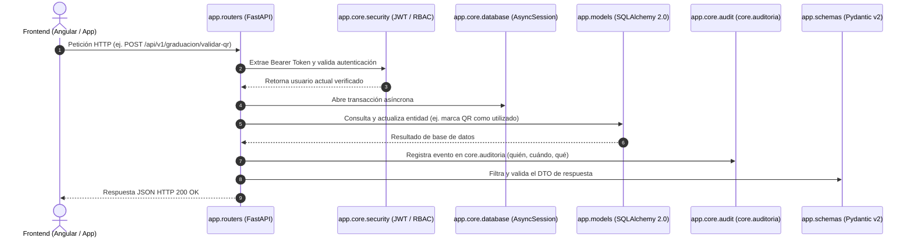

# 🏛️ Estructura y Arquitectura del Backend — ITQ Conecta

Este documento describe detalladamente la organización de carpetas y archivos del backend (`itq_backend`), explicando la responsabilidad de cada componente dentro del sistema.

---

## 📂 Mapa General de Directorios

```plaintext
itq_backend/
│
├── .env                          # Variables de entorno locales (credenciales, secretos, BD)
├── requirements.txt              # Dependencias de Python del proyecto
│
├── app/                          # Código fuente principal de la aplicación
│   ├── __init__.py
│   ├── main.py                   # Punto de entrada de FastAPI, CORS y registro de rutas
│   │
│   ├── core/                     # Configuración transversal, seguridad y base de datos
│   │   ├── __init__.py
│   │   ├── config.py             # Lectura de variables de entorno con Pydantic Settings
│   │   ├── database.py           # Conexión asíncrona a PostgreSQL (AsyncSession / SQLAlchemy 2.0)
│   │   ├── security.py           # Hashing bcrypt, tokens JWT y dependencia de usuario actual
│   │   └── audit.py              # Servicio de registro de trazabilidad en core.auditoria
│   │
│   ├── models/                   # Modelos de base de datos ORM (SQLAlchemy 2.0)
│   │   ├── __init__.py
│   │   ├── core.py               # Tablas del esquema 'core': personas, usuarios, roles, auditoría
│   │   ├── documentos.py         # Tablas del esquema 'docs': gestión documental transversal
│   │   └── graduacion.py         # Tablas del esquema 'graduacion': eventos, butacas, pases, QR
│   │
│   ├── schemas/                  # Validación de datos y DTOs (Pydantic v2)
│   │   ├── __init__.py
│   │   ├── auth.py               # Contratos de petición/respuesta de login y sesión
│   │   ├── core.py               # Contratos de consulta de personas y usuarios
│   │   └── graduacion.py         # Contratos de eventos, validación de QR y pases
│   │
│   └── routers/                  # Controladores y endpoints de la API REST (/api/v1)
│       ├── __init__.py
│       ├── auth.py               # Endpoints de autenticación (/auth/login, /auth/me)
│       ├── core.py               # Endpoints institucionales (/core/personas, /core/usuarios)
│       └── graduacion.py         # Endpoints de ceremonia (/graduacion/eventos, validar-qr)
│
└── scripts/                      # Scripts de utilidad, mantenimiento y base de datos
    ├── create_schemas.sql        # Script DDL SQL para crear esquemas, tablas e índices
    ├── check_db.py               # Script para verificar conectividad con PostgreSQL
    └── seed_admin.py             # Script de siembra para el superusuario administrador
```

---

## 📋 Detalle por Carpeta y Archivo

### 1. Raíz (`itq_backend/`)
Contiene los archivos de configuración y dependencias globales del proyecto:
* **`.env`**: Archivo local donde se configuran los secretos y variables de entorno (`DATABASE_URL`, `SECRET_KEY`, `ACCESS_TOKEN_EXPIRE_MINUTES`, etc.).
* **`requirements.txt`**: Lista de librerías requeridas por el proyecto: FastAPI, Uvicorn, SQLAlchemy 2.0, Asyncpg, Passlib con Bcrypt, Python-Jose (JWT), Pydantic v2, etc.

---

### 2. `app/` — Código Central del Backend
Es el paquete raíz donde vive toda la lógica de negocio y la API.

* **`main.py`**:
  * Es el archivo que arranca FastAPI (`uvicorn app.main:app`).
  * Define el ciclo de vida de la aplicación (`lifespan`).
  * Configura los encabezados y permisos de **CORS** para la conexión con el frontend (Angular).
  * Incluye e integra todos los routers de los distintos módulos bajo el prefijo unificado `/api/v1`.
  * Expone endpoints de salud (`/` y `/api/v1/health`).

---

### 3. `app/core/` — Servicios Transversales y Configuración
Contiene la infraestructura compartida que alimenta a todos los módulos:

* **`config.py`**: Utiliza `pydantic-settings` para cargar y validar tipadamente todas las variables de entorno definidas en el `.env`.
* **`database.py`**:
  * Crea el motor asíncrono `create_async_engine` conectado a PostgreSQL mediante `asyncpg`.
  * Configura el pool de conexiones y la fábrica `AsyncSessionLocal`.
  * Define la clase base declarativa `Base` para todos los modelos ORM.
  * Expone la dependencia FastAPI `get_db` que inyecta sesiones asíncronas seguras por cada petición HTTP.
* **`security.py`**:
  * Funciones de hashing seguro de contraseñas (`hash_password`, `verify_password`) con `bcrypt`.
  * Generación y decodificación de tokens de sesión **JWT** (`create_access_token`, `decode_access_token`).
  * Dependencia `get_current_user` que extrae el token Bearer del encabezado HTTP `Authorization`, valida el usuario en la BD y garantiza que esté activo.
* **`audit.py`**:
  * Función asíncrona `registrar_auditoria(...)` encargada de persistir eventos de trazabilidad en la tabla `core.auditoria` (usuario, módulo, acción, tabla afectada, IP, timestamp).

---

### 4. `app/models/` — Modelos ORM (Base de Datos)
Define las entidades mapeadas directamente a las tablas de PostgreSQL, respetando la arquitectura de esquemas:

* **`core.py`** *(Esquema: `core`)*:
  * `Persona`: Registro maestro de personas físicas (cédula, nombres, apellidos, contacto).
  * `Usuario`: Credenciales de acceso institucionales vinculadas a una persona.
  * `Rol` y `UsuarioRol`: Modelado de roles y asignación multi-rol (RBAC).
  * `Auditoria`: Registro histórico de acciones y seguridad.
* **`documentos.py`** *(Esquema: `docs`)*:
  * `FileAsset`: Almacenamiento físico de archivos (rutas, tamaño, checksum SHA-256).
  * `Document`: Entidad lógica de documento ligada a un módulo del sistema (origen, estado).
  * `DocumentVersion`: Control de versiones sucesivas de un mismo documento.
  * `DocumentReview`: Flujos de aprobación, observaciones y rechazos.
* **`graduacion.py`** *(Esquema: `graduacion`)*:
  * `Evento`: Ceremonias de graduación, fechas, jornadas, aforos y sedes.
  * `Butaca`: Matriz de asientos por fila y número.
  * `Pase`: Boletos asignados a estudiantes o invitados.
  * `QR`: Códigos criptográficos de acceso con validación de un solo uso e historial de escaneo.

---

### 5. `app/schemas/` — Validación y Serialización (DTOs)
Utiliza Pydantic v2 para tipar y validar las entradas y salidas de la API, previniendo datos inválidos y filtrando información sensible (como hashes de contraseñas):

* **`auth.py`**:
  * `LoginRequest`: Valida usuario/correo y contraseña entrantes.
  * `TokenResponse`: Formato del token JWT devuelto.
  * `UsuarioMeResponse`: Información del perfil de usuario y lista de roles activos para el frontend.
* **`core.py`**:
  * `PersonaOut`: Salida formateada de datos personales.
  * `UsuarioOut` y `UsuarioListOut`: Serialización de listas de usuarios con paginación (`total`, `skip`, `limit`).
* **`graduacion.py`**:
  * `EventoOut`, `EventoListOut`, `ButacaOut`: Estructura pública de ceremonias y asientos.
  * `ValidarQRRequest` y `ValidarCedulaRequest`: Parámetros de consulta para los puntos de control.
  * `PaseValidoResponse`: Respuesta completa al escanear un pase válido.

---

### 6. `app/routers/` — Controladores de la API REST
Implementa los endpoints HTTP consumidos por el cliente (Angular / móvil):

* **`auth.py`** (`/api/v1/auth`):
  * `POST /login`: Valida credenciales, audita el acceso y retorna el JWT.
  * `GET /me`: Consulta los datos del usuario conectado (requiere JWT).
* **`core.py`** (`/api/v1/core`):
  * `GET /personas/buscar`: Busca personas por cédula en el padrón institucional.
  * `GET /usuarios`: Lista paginada de cuentas registradas con sus roles.
* **`graduacion.py`** (`/api/v1/graduacion`):
  * `GET /eventos`: Consulta de eventos activos.
  * `POST /validar-qr`: Validación en tiempo real del código QR escaneado en el acceso.
  * `POST /validar-cedula`: Alternativa manual para validar ingreso por número de cédula.

---

### 7. `scripts/` — Herramientas de Mantenimiento y Setup
Scripts auxiliares para administración y despliegue del backend:

* **`create_schemas.sql`**: Script DDL que ejecuta la creación de los esquemas PostgreSQL (`core`, `docs`, `graduacion`), tablas, llaves foráneas, índices, roles base y usuario admin inicial.
* **`check_db.py`**: Diagnóstico rápido de red y PostgreSQL que verifica la conectividad y la presencia de los esquemas requeridos.
* **`seed_admin.py`**: Permite sembrar o restablecer la cuenta de usuario administrador (`admin`) asignándole el rol `administrador` con contraseña cifrada.

---

## 🔄 Flujo de una Petición Típica en el Backend


